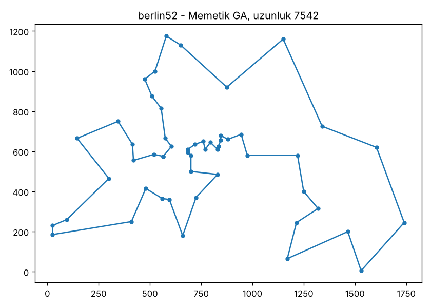
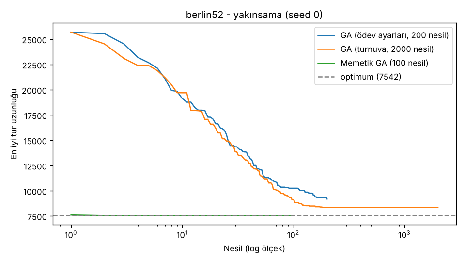

# Genetik Algoritma ile Gezgin Satıcı Problemi (TSP)

*Genetic algorithm for the TSP, benchmarked on 4 TSPLIB instances against nearest neighbour and 2-opt. A plain GA stays 5-13% above the optimum; a memetic GA (GA + 2-opt on every child) finds the known optimum on berlin52 and kroA100 in 10/10 runs.*

Ders ödevi olarak yazdığım genetik algoritmayı (OX çaprazlama, inversion mutasyonu, elitizm) bilinen optimum çözümü olan TSPLIB problemlerinde denedim. Klasik yöntemlerle karşılaştırdım. Sade GA'nın 2-opt'u bile geçemediğini görünce GA'ya yerel arama ekleyip memetik algoritmaya çevirdim.



## Yöntemler

| Yöntem | Açıklama |
|---|---|
| En yakın komşu | her adımda gidilmemiş en yakın şehre git, her şehirden başlatılıp en iyisi alınıyor |
| En yakın komşu + 2-opt | en yakın komşu turuna 2-opt yerel arama (iki kenarı çıkarıp arayı ters çevirme) |
| GA (ödev ayarları) | ödevdeki ayarlar: 100 birey, 200 nesil, ebeveynler en iyi 20 bireyden |
| GA (turnuva) | turnuva seçimi, 300 birey, 2000 nesil |
| GA (turnuva) + 2-opt | GA'nın bulduğu tura sonda bir kez 2-opt |
| Memetik GA | her çocuğa 2-opt uygulanıyor, 30 birey, 100 nesil |

GA'larda başlangıç şehri sabit (0), birey kalan şehirlerin sırası. Çaprazlama OX (ordered crossover), mutasyon bir parçayı ters çevirme, en iyi 2 birey bir sonraki nesle aynen geçiyor.

## Sonuçlar

Her GA ayarı 10 farklı seed ile çalıştırıldı. Sapma: bulunan uzunluğun bilinen optimuma göre yüzde farkı.

### Ortalama sapma (%)

| Yöntem | eil51 | berlin52 | st70 | kroA100 |
|---|---|---|---|---|
| En yakın komşu | 23,45 | 24,31 | 24,63 | 27,09 |
| En yakın komşu + 2-opt | 3,88 | 7,13 | 6,23 | 4,04 |
| GA (ödev ayarları) | 18,87 | 20,95 | 42,09 | 84,78 |
| GA (turnuva) | 8,71 | 10,16 | 8,77 | 13,14 |
| GA (turnuva) + 2-opt | 5,94 | 8,39 | 5,51 | 8,59 |
| **Memetik GA** | **0,16** | **0,00** | **0,22** | **0,00** |

### Memetik GA'nın optimumu bulduğu çalıştırma sayısı

| eil51 (426) | berlin52 (7542) | st70 (675) | kroA100 (21282) |
|---|---|---|---|
| 4 / 10 | 10 / 10 | 7 / 10 | 10 / 10 |

Diğer GA ayarları hiçbir çalıştırmada optimumu bulamadı. En iyi değerler, süreler ve tüm satırlar `sonuclar/karsilastirma.csv` dosyasında.



## Çıkardığım sonuçlar

- **Ödev ayarları küçük problemde idare ediyor, büyüdükçe çöküyor.** Ebeveynler hep en iyi 20 bireyden seçildiği için popülasyon çabuk birbirine benziyor. 100 şehirde ortalama %85 sapma var.
- **Turnuva seçimi ve uzun çalışma GA'yı belirgin şekilde iyileştiriyor ama yine de 2-opt'un gerisinde.** 2000 nesil boyunca yaklaşık 600.000 tur üretmesine rağmen ortalamada en yakın komşu + 2-opt'tan kötü sonuç veriyor. Grafikte turnuva GA'nın 200. nesilden sonra neredeyse hiç ilerlemediği görülüyor.
- **Memetik GA en iyi sonucu daha az hesapla veriyor.** 2-opt her bireyi yerel optimuma taşıdığı için GA sadece yerel optimumlar arasında arama yapıyor. 30 birey ve 100 nesil yetti, süre turnuva GA'nın yarısından az.
- 2-opt'lu yöntemler arasında da fark büyük: tek bir başlangıç turuna 2-opt uygulamak bir yerel optimumda kalıyor, GA ise farklı yerel optimumları birleştirip daha iyisini buluyor.

## Dosyalar

| Dosya | Ne işe yarıyor |
|---|---|
| `odev/ga_tsp_odev.py` | ödevde teslim ettiğim ilk sürüm (21 şehirlik Excel mesafe matrisi ile) |
| `tsplib.py` | `.tsp` dosyası okuma, mesafe matrisi, bilinen optimumlar |
| `yontemler.py` | en yakın komşu, 2-opt, genetik algoritma (memetik seçeneğiyle) |
| `karsilastir.py` | tüm yöntemleri 4 problemde çalıştırıp csv ve grafik üretiyor |
| `veri/` | TSPLIB problemleri: eil51, berlin52, st70, kroA100 |
| `sonuclar/` | karşılaştırma tablosu ve grafikler |

## Çalıştırma

```
pip install -r requirements.txt
python karsilastir.py
```

Tamamı yaklaşık 15-20 dakika sürüyor (2 çekirdekli işlemcide). Seedler sabit olduğu için sonuçlar her çalıştırmada aynı çıkıyor.

Ödev sürümü `distance_matrix.xlsx` dosyasını okuyor. Ödevde verilen bu dosya elimde kalmadığı için repoya eklenmedi.

## Veri

Problemler ve optimum değerler TSPLIB'den (Reinelt, G. "TSPLIB - A Traveling Salesman Problem Library", ORSA Journal on Computing, 1991). Mesafeler TSPLIB'in EUC_2D kuralına göre: Öklid mesafesi en yakın tam sayıya yuvarlanıyor.

## Lisans

MIT
